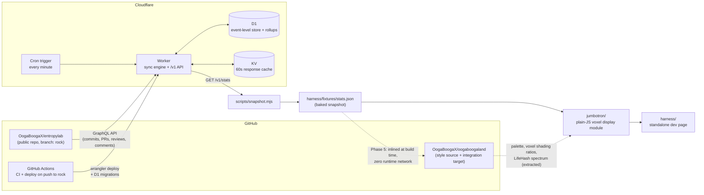

# Oogatron

A jumbotron for the voxel world. Oogatron collects contributor analytics from
[OogaBoogaX/entropylab](https://github.com/OogaBoogaX/entropylab), stores them
event-by-event in Cloudflare D1, serves them from a Cloudflare Worker, and
renders them on a voxel jumbotron screen built to sit inside
[OogaBoogaX/oogaboogaland](https://github.com/OogaBoogaX/oogaboogaland) — the
dependency-free WebGL2 floating-island world whose voxel cavemen already
represent entropylab contributors.

See [CLAUDE.md](CLAUDE.md) for the full project spec (the source of truth for
scope, schema, and conventions).

## Architecture



Three pieces, deliberately decoupled:

| Piece | What it is | Stack |
| --- | --- | --- |
| `worker/` | Data service: polls the OogaBoogaX org's repos over the GitHub GraphQL API on a per-minute cron, stores every commit / PR / review / comment as an individual event in D1, recomputes daily rollups, and serves a frozen, versioned JSON contract at `/v1/*` with KV caching | TypeScript on Cloudflare Workers + D1 + KV |
| `jumbotron/` | The display: parses the stats JSON, renders LED-board views (totals, per-type leaderboards, per-contributor cards with identicons and sparklines, a scrolling ticker) onto an offscreen canvas, and shows it on a flat-shaded voxel screen mesh | Plain JavaScript, zero dependencies, no build step |
| `harness/` | Standalone dev page: orbit camera, view controls, live-or-fixture data switching, and a Canvas-2D fallback (`?canvas2d=1`) | One static HTML file |

Design principles, from the spec:

- **Cron polling only** — no webhooks (they would need admin on entropylab).
  Ingestion is budget-metered and resumable, so a full history backfill
  completes across multiple Worker invocations.
- **Event-level storage** — not counters — so any later filtering by
  contributor, type, or time window needs no schema change.
- **Snapshot-first integration** — the jumbotron module never fetches.
  Data is always pushed in via `update(statsJson)`; oogaboogaland will bake
  the snapshot in at build time and stay zero-network at runtime.
- **Bots are stored but excluded by default** (`?include_bots=1` overrides),
  and unmatched commit emails become salted-hash identities — raw emails are
  never stored.

## How activity is counted

Events are stored raw and complete. Two things are decided from them, as
events change, and stored so no read path re-derives a rule per request:

- **Activity** (`activity_events.counted`): every distinct event. The recent
  feed, each contributor's last activity per repo, and who counts as a
  contributor at all read this. A push to a PR branch, a comment or a merge
  is activity the moment it happens.
- **Contributions** (`daily_rollups.tally`): what the counts and leaderboards
  serve. Every activity event is one, except that a commit counts only once
  it is on the default branch, as on GitHub's contribution graph
  (`activity_events.landed`, `TALLIED` in `worker/src/db/rollups.ts`).

The rules:

- **Commits** come from each repo's default branch **and every PR's branch**,
  whatever the PR's state, so work is activity as soon as it's pushed. Both
  walkers share one commit-to-event mapping (`commitEvent` in
  `worker/src/sync/commits.ts`); a SHA reached both ways is one row. A commit
  is *landed* when the default-branch walk reaches it, or when its PR was
  merged into the default branch with a merge commit (two parents), which
  puts the branch's own SHAs there. A commit on a branch alone is activity, not a
  contribution.
- **Merges:** a merged PR is one `merge` for whoever pressed the button, its
  own count (`merges`), not a commit. The merge commit is its author's
  commit, as it is on GitHub.
- **Patch identity:** a rebase merge, a rebased PR branch or an `--amend`
  leaves the same patch under several SHAs. Commits with the same repo,
  author, author date and headline count once: a copy on the default branch
  before one on a branch alone, then the newest.
- **Squash merges:** the PR's branch commits are their authors' activity; the
  squash commit, which GitHub authors as the PR's author, is the
  contribution.
- **Bots** are stored under one canonical `name[bot]` login (GitHub's GraphQL
  says `dependabot` for a PR author but `dependabot[bot]` for a commit author,
  with the same account id) and excluded from responses by default.

## API

All responses are JSON with CORS enabled for GET, cached in KV for 60 seconds,
and carry `meta: { generated_at, repo, schema_version }`.

| Endpoint | Returns |
| --- | --- |
| `GET /v1/stats` | Legacy schema 2: totals, leaderboards, and the complete per-contributor breakdown with weekly buckets (commits, PRs, reviews only) |
| `GET /v2/stats` | Schema 3, the snapshot format: everything above plus `issues`/`comments`, per-repo leaderboards and last activity, and `recent` — the newest 12 events per (repo, contributor, type) cell, so the island's client-side filters never run dry |
| `GET /v1/contributors` | Roster with lifetime counts (no weekly detail) |
| `GET /v1/contributors/{login}` | One contributor, with `?from=`, `?to=`, `?type=` filters recomputed from raw events |
| `GET /v1/health` | Last sync run, cursors, and row counts |
| `POST /admin/backfill` | Bearer-token protected; runs one budget-bounded sync slice (loop until `done: true` to drive a full backfill) |

The contract is frozen at `schema_version: 1`; only additive changes are
allowed. `scripts/lib/validate-stats.mjs` is the dependency-free validator
shared by the test suite, the snapshot script, and the jumbotron's data layer,
so the fixture and the live API can never drift apart silently.

## Running locally

The jumbotron and harness are static files — any static server works:

```sh
python3 -m http.server 8765
# then open:
#   http://localhost:8765/harness/                 fixture data (offline)
#   http://localhost:8765/harness/?src=<worker>    live data from a deployed worker
#   http://localhost:8765/harness/?canvas2d=1      Canvas-2D fallback path
```

Worker development and tests (vitest running inside the real Workers runtime,
with recorded GraphQL fixtures — no network):

```sh
cd worker
npm install
npm test           # sync engine, rollups, API, contract tests
npm run typecheck
npm run dev        # local dev server via wrangler
```

Harness smoke test (headless Chrome, fails on any console error in either
render path):

```sh
npm install        # repo root
npm run smoke
```

## Deployment

One-time provisioning in a Cloudflare account (IDs go in
`worker/wrangler.toml`; they are not secrets):

```sh
cd worker
wrangler d1 create oogatron
wrangler kv namespace create CACHE
wrangler d1 migrations apply oogatron --remote
wrangler secret put GITHUB_TOKEN   # fine-grained PAT, public-repo read-only
wrangler secret put ADMIN_TOKEN    # e.g. openssl rand -hex 32
wrangler deploy
```

Then drive the initial backfill until it reports `done: true`:

```sh
curl -X POST -H "Authorization: Bearer $ADMIN_TOKEN" https://<your-worker>/admin/backfill
```

CI/CD runs entirely in GitHub Actions: `ci.yml` (typecheck, lint, tests,
harness smoke) on every PR and push to `rock`, and `deploy.yml` (D1 migrations
+ `wrangler deploy`) on push to `rock`, using the `CLOUDFLARE_API_TOKEN` and
`CLOUDFLARE_ACCOUNT_ID` repo secrets. Nothing is org-specific, so the repo can
transfer with only a secrets re-check.

## Operations

### Usage and cost

The per-minute cron makes D1 usage the thing to watch. D1 bills rows read and
written, not bytes stored — the database itself is only a few MB. In steady
state the worker reads roughly 0.8M rows and writes roughly 9k rows per hour
(about 0.6B reads and 6M writes a month), comfortably inside the Workers Paid
plan's included 25B reads and 50M writes.

Keeping it there depends on a few rules the code enforces; keep them when
changing it:

- **Never re-derive dedupe per request.** Filter on `counted` (the `COUNTED`
  constant in `worker/src/db/rollups.ts`). Correlated subqueries in the stats
  path once cost ~570k row reads per cache miss.
- **The recent feed reads a bounded slice, never all history.** Each
  (repo, contributor, type) is read back to its 48th newest counted event on
  `idx_events_counted_recent`, about 3,800 rows in all instead of every counted
  event. A row past its own type's eleventh one-minute window can never be
  kept (see `shortGroups` in `worker/src/db/recent.ts`), so a group whose
  slice stops short of that point is read whole, and the feed is exactly what
  all history gives. It relies on GitHub's `YYYY-MM-DDTHH:MM:SSZ` timestamps
  sorting as text in time order; a group with any other form is read whole.
- **Rollups follow events; never recount them per sync.** Migration 0012's
  triggers move an event's `daily_rollups` bucket as it is inserted, edited,
  (un)counted or deleted, and note in `counted_dirty` every commit identity
  group or oid whose dedupe may have moved; `reconcileRollups` re-evaluates
  only those commits, by index seeks. A sync that writes one event reads tens
  of rows for it instead of the ~230k a rebuild from all history costs. The
  full `recomputeRollups` stays for migrations, cleanups and a once-a-day
  check that logs `rollups_drift` if it ever has to fix anything. Count
  written events from the upsert's `RETURNING`, never `meta.changes`, which
  includes what the triggers write.
- **Every upsert is guarded** so an unchanged row writes nothing. The sync
  re-fetches overlap windows every minute; unguarded writes to events or
  contributors turn that into millions of rewrites a day.
- **Both commit walkers must emit byte-identical payloads**, or the guarded
  upsert flips the row between them every run and forces a rollup
  reconcile and a stats rebuild each tick.

To check usage:

```sh
cd worker
npx wrangler d1 info oogatron                      # 24h rows read/written
npx wrangler d1 insights oogatron --timePeriod 1h --sort-by reads   # or writes
```

### Sync health

`GET /v1/health` shows the last run, each repo/source cursor and its phase
(`backfill` or `incremental`), and row counts. `freshness` reports the latest
attempt, latest successful finish and whether ingestion is healthy. Its age
measures sync time, not the response's `generated_at` or an event's date:
a quiet repository can be freshly checked without having new contributions.
Each cursor's `age_seconds` measures its last persisted check/page. Attempts
are recorded in `sync_runs` before initialization (kept for one day).

- **A killed run** (e.g. the runtime disconnects the cron invocation) never
  marks itself finished, and later runs skip while it looks active. The
  stale-run guard reclaims it after `STALE_RUN_MINUTES` (5) and syncing
  resumes on its own. GitHub requests time out after 20 seconds so a hung
  request can't cause this.
- **A run erroring every minute** (`status: error` with the same message) means
  initialization or a sync page is failing; its phase and error identify where.
  Cursors retain completed pages. Fix the cause and deploy — the next run
  resumes from the stored cursors.
- **No new attempts** can mean missing cron delivery or a failure before D1
  can record the attempt. Check Cloudflare Cron Events and the
  `cron_sync_failed` log, which includes the expression and scheduled time.
  Handler failures propagate to Cloudflare rather than appearing as successful
  invocations. Manage the every-minute `*/1 * * * *` trigger in
  `worker/wrangler.toml`; schedule changes can take up to 15 minutes to propagate.

### Re-walking history

`0009_canonical_lightningfoundry.sql` consolidates the historical
`lightningfactory`, `lightning-foundry`, and separator/case variants into
`lightningfoundry`. Only repeated `external_id` values within that rename
family are removed; distinct events remain, even at the same timestamp.
On a duplicate, the canonical row's payload wins, or the last ingested alias
copy if no canonical row exists. Existing merge/patch counting rules are then
re-applied and the repository's rollups rebuilt immediately. BananaPayServer
remains a separate repository.

The migration consolidates discovery metadata and clears only Foundry's
opaque sync cursors for a canonical re-walk. Discovery and persistence now
normalize the historical names. Database guards reject retired-name writes
from an old worker between migration and deployment: an overlapping old run
can fail with `retired repository alias: use lightningfoundry`, rolling back
its whole page and cursor advance. Its replacement retries canonically; no
event page is skipped. The migration also leaves a one-time
`*/foundry_cleanup` marker: after the old run finishes, the new worker resets
Foundry's cursors again, rebuilds all rollups (including any earlier pages
the old run committed), and invalidates the response cache before removing
the marker. A failure keeps it pending for a safe retry. Check health after
deployment for recurring failures, and confirm the marker is gone before
baking a new snapshot. Cached pre-migration responses can remain for up to
60 seconds before that finalization; a fresh query string bypasses them.

A migration that deletes `sync_state` rows (as `0005` and `0008` do) makes
those repos re-read their full history. A run that started before the
migration can write its old cursors back afterward, silently skipping the
re-walk for some repos. Check `/v1/health` afterward; to reset a repo by hand,
guard against an in-flight run:

```sh
npx wrangler d1 execute oogatron --remote --command \
  "DELETE FROM sync_state WHERE source IN ('commits','prs') AND repo = '<repo>'
   AND NOT EXISTS (SELECT 1 FROM sync_runs WHERE status = 'running')"
```

`changes: 0` means a run was in progress — retry a few seconds later (runs
start each minute and take under 30 seconds).

### Deploy notes

- Normal deploys happen by merging to `rock`. A manual `wrangler deploy`
  ships whatever branch is checked out, and the next push to `rock`
  overwrites it — land manual deploys on `rock` promptly.
- Stacked PRs: GitHub does not always retarget a PR to `rock` when its base
  branch merges. Confirm the base before merging, or the change lands on the
  old branch and never deploys.

## oogaboogaland integration

The jumbotron is built to be dropped into oogaboogaland as a prop
(spec "Phase 5", a separate effort against that repo):

- **Zero runtime network.** oogaboogaland's CSP and privacy promise forbid
  runtime requests, so the stats snapshot is inlined at build time by its
  build script; a scheduled workflow there re-bakes it periodically.
  `scripts/snapshot.mjs` produces exactly that artifact.
- **Engine-agnostic mesh.** The module takes a `WebGL2RenderingContext` and a
  view-projection matrix — it owns only its model transform — so it can be
  drawn by oogaboogaland's renderer directly, or re-meshed with the island's
  native `box()`/`BL.models.merge` builders during integration.
- **Interaction hook.** The per-contributor card view exists so that "poke an
  Ooga → the jumbotron shows their stats" becomes a one-call integration:
  `jumbotron.setView("contributor", { login })`.
- **Fallback parity.** The Canvas-2D display core mirrors oogaboogaland's
  `?canvas2d=1` degradation strategy.

To make it read as native, the visual style was extracted from a clone of the
oogaboogaland source rather than invented: the palette tokens in
`jumbotron/views.js` carry the island's actual material colors (wood, plank,
paper, its amber accent, the matrix-green and teal of its in-world lab
screens), the cabinet copies its crate's frame-to-panel proportions, per-face
shading uses the measured day ratios of its lighting model
(top : lit : dark : bottom ≈ 1.0 : 0.75 : 0.5 : 0.33), and contributor
identicons draw their colors from the same LifeHash spectrum its identicon
system uses.

## Sources & credits

- **Data:** the public activity of
  [OogaBoogaX/entropylab](https://github.com/OogaBoogaX/entropylab), ingested
  via the [GitHub GraphQL API](https://docs.github.com/en/graphql) (with the
  REST API used for count verification). Public contributor handles and public
  activity only — no private data of any kind.
- **Visual style:**
  [OogaBoogaX/oogaboogaland](https://github.com/OogaBoogaX/oogaboogaland) —
  palette values, voxel shading ratios, screen/cabinet proportions, and HUD
  language extracted from its source.
- **Identicon colors:** the color spectrum of
  [LifeHash](https://github.com/BlockchainCommons/bc-lifehash) by Blockchain
  Commons (BSD-2-Clause-Patent), which oogaboogaland ports for its in-world
  identicons.
- **Platform:** [Cloudflare Workers, D1, and KV](https://developers.cloudflare.com/workers/);
  deploys via [`cloudflare/wrangler-action`](https://github.com/cloudflare/wrangler-action).
